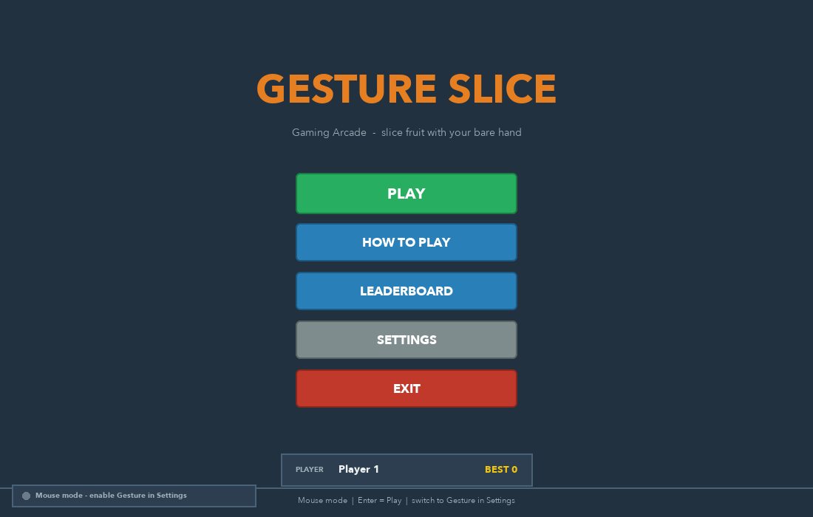
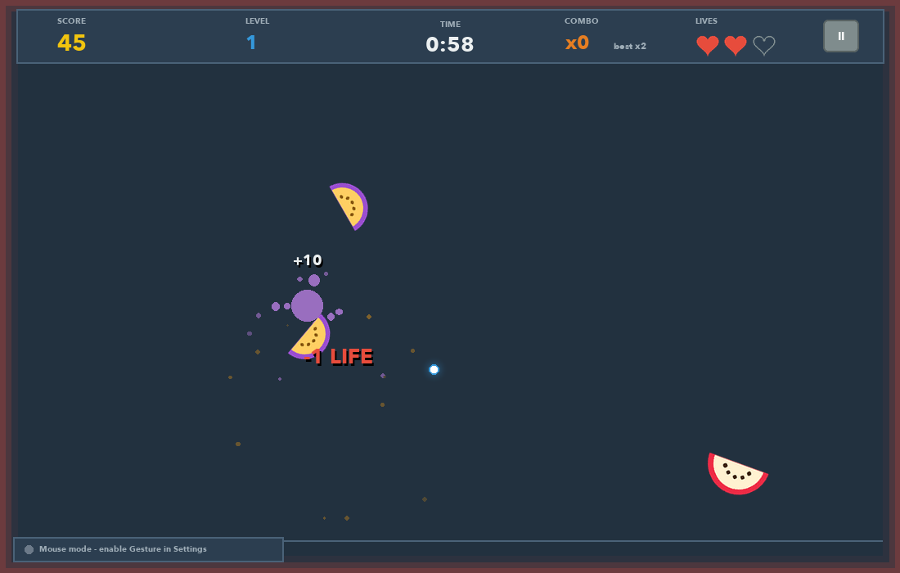

# Gaming Arcade: Gesture Slice

Our project for **Advanced Programming Practices (APP)**.

Gesture Slice is a fruit slicing game made in **Python with Tkinter**. You play it with your
**hand in front of the webcam**. The program finds your index fingertip and uses it as a knife.
Swipe through the fruit to cut it, and stay away from the bombs.



## Features

- Hand tracking with the webcam (OpenCV + MediaPipe)
- Index fingertip = knife; a fast swipe cuts the fruit
- Open palm = pause, fist = resume
- Hover your finger on a button for about 1 second to press it (no mouse needed)
- Score, combos, levels, 3 lives, and bombs
- Leaderboard and player stats saved in a SQLite database
- Mouse mode if you don't have a webcam



## How to run

You need **Python 3.9 to 3.12** (we used 3.11). MediaPipe doesn't work on 3.13 yet.

```bash
git clone https://github.com/s-shriya2288/APP-project.git
cd APP-project
python3.11 -m venv .venv
source .venv/bin/activate        # Windows: .venv\Scripts\activate
pip install -r requirements.txt
python main.py
```

The first time you run it, macOS asks if Terminal can use the camera. Click **Allow**.

## How to play

| Action | What to do |
|---|---|
| Move the knife | Point your index finger at the camera |
| Cut fruit | Swipe fast through it (slow moves only aim) |
| Pause | Hold an open palm still for a moment |
| Resume | Make a fist and hold it |
| Press a button | Keep your fingertip on it until the bar fills |
| Keyboard | Space / P = pause, Esc = back to menu |

Points: normal fruit = 10, golden star = 20, and cutting 2 or more fruits in one swipe gives a combo bonus.
Hitting a bomb costs one life. The round ends when time runs out or you lose all 3 lives.

## Technologies used

| Library | What we used it for |
|---|---|
| **Tkinter** | The window, all screens, drawing the game, the game loop |
| OpenCV | Reading frames from the webcam |
| MediaPipe | Finding the 21 points of the hand in each frame |
| NumPy | Maths (distances, smoothing) and making sound effects |
| Pillow | Drawing the fruit and button images |
| SQLite (`sqlite3`) | Saving players, games, high scores and stats |
| pygame | Only for playing sounds |

## Where we used Tkinter

Most of the Tkinter code is in [`gesture_slice/ui.py`](gesture_slice/ui.py).

- `tk.Tk()` creates the main window.
- One big `tk.Canvas` is used for everything. Fruit, bombs, buttons, the score and the knife trail
  are canvas items made with `create_image`, `create_text`, `create_line` and `create_oval`,
  and moved every frame with `canvas.coords()`.
- `canvas.bind("<Motion>")`, `bind("<Button-1>")` and `root.bind("<Key>")` handle the mouse and keyboard.
- `tk.Entry` is the text box for the player name on the Settings screen.
- **The game loop:** `root.after(16, self._tick)` runs about 60 times a second. Each time it reads
  the hand position, updates the game and redraws.
- `ImageTk.PhotoImage` shows the small camera preview in the corner.

**Why we use a thread:** Tkinter can only run on one thread, and reading the webcam is slow. If we
read the camera inside the game loop, the window would freeze. So the camera and MediaPipe run in a
**background thread** (`hand_tracking.py`), which puts the hand position into a `queue.Queue`.
The Tkinter loop just takes the newest value from the queue every frame.

## How it works

```
Webcam -> hand_tracking.py -> gesture_detection.py -> game_engine.py -> ui.py (Tkinter window)
          (OpenCV+MediaPipe)   (finger position,       (rules, score,       |
           background thread)   palm / fist)            collisions)         v
                                                                       database.py (SQLite)
```

1. **hand_tracking.py** reads a frame, flips it like a mirror and finds the hand landmarks.
2. **gesture_detection.py** maps the fingertip to the screen, smooths it (One Euro filter),
   works out the speed, and checks if the hand is an open palm or a fist.
3. **game_engine.py** moves the fruit with gravity, checks if the swipe line touches a fruit,
   and updates the score, combos, lives and level.
4. **ui.py** draws everything on the Tkinter canvas.
5. **database.py** saves the result when the game ends.

**Collision check:** in each frame the fingertip moves from point A to point B. A fruit is cut if
the shortest distance from its centre to the line AB is less than its radius, and the finger
was moving fast enough. More details are in [docs/HOW_IT_WORKS.md](docs/HOW_IT_WORKS.md).

## Project structure

```
APP-project/
├── main.py                  starts the app
├── gesture_slice/
│   ├── config.py            all settings and constants
│   ├── ui.py                Tkinter window and screens
│   ├── game_engine.py       game rules + drawing the game
│   ├── fruit.py             Fruit, Bomb classes and collision maths
│   ├── hand_tracking.py     webcam + MediaPipe (background thread)
│   ├── gesture_detection.py fingertip, smoothing, palm/fist
│   ├── particle_effects.py  juice drops and knife trail
│   ├── sprites.py           draws fruit/button images with Pillow
│   ├── sound.py             sound effects
│   ├── database.py          SQLite
│   └── utils.py             small helper functions
├── tests/                   unit tests
├── docs/                    extra documentation and screenshots
├── website/                 project web page (Vercel)
└── scripts/                 build the desktop app
```

## Database

There are 4 main tables: `players`, `game_sessions`, `high_scores` and `game_statistics`
(plus `settings`). Every finished game is saved in one transaction. See [docs/DATABASE.md](docs/DATABASE.md).

## Testing

```bash
python -m unittest discover -s tests -v
```

There are 36 unit tests for the collision maths, physics, game rules, gestures and database.
GitHub Actions runs them on every push ([.github/workflows/ci.yml](.github/workflows/ci.yml)).

## Making a desktop app

```bash
pip install -r requirements-dev.txt
./scripts/build_desktop_app.sh      # Windows: scripts\build_desktop_app.bat
```

This uses PyInstaller to make `dist/GestureSlice.app` (or `GestureSlice.exe` on Windows),
which you can open by double-clicking it.

## Problems we faced

| Problem | Fix |
|---|---|
| Window froze while reading the camera | Moved the camera to a background thread with a queue |
| Knife was shaky | Added a One Euro filter to smooth the fingertip |
| Pause triggered by accident | The palm/fist has to be held for 0.7 s before it counts |
| Camera blocked on macOS | System Settings → Privacy & Security → Camera → turn on the app/Terminal |
| `mediapipe` doesn't install | Use Python 3.9 to 3.12 |

## More docs

- [docs/ARCHITECTURE.md](docs/ARCHITECTURE.md): classes and how the files connect
- [docs/HOW_IT_WORKS.md](docs/HOW_IT_WORKS.md): gestures, collision and physics
- [docs/DATABASE.md](docs/DATABASE.md): tables and queries
- [docs/WORKFLOW.md](docs/WORKFLOW.md): how we built it step by step
- [docs/DEMO_GUIDE.md](docs/DEMO_GUIDE.md): what to show in the demo

## License

MIT
