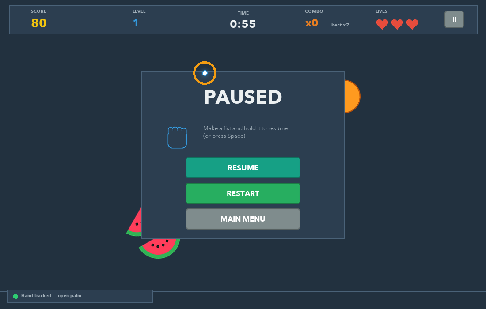
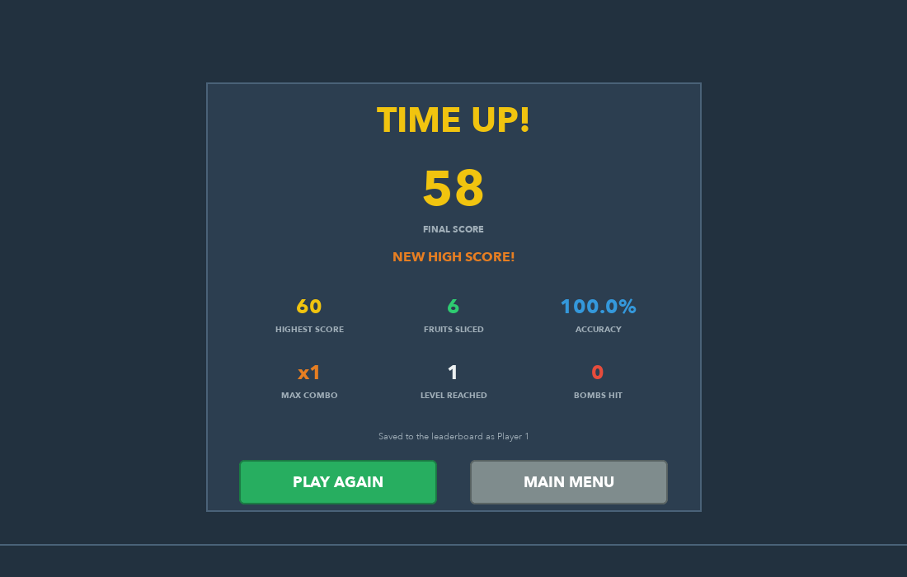
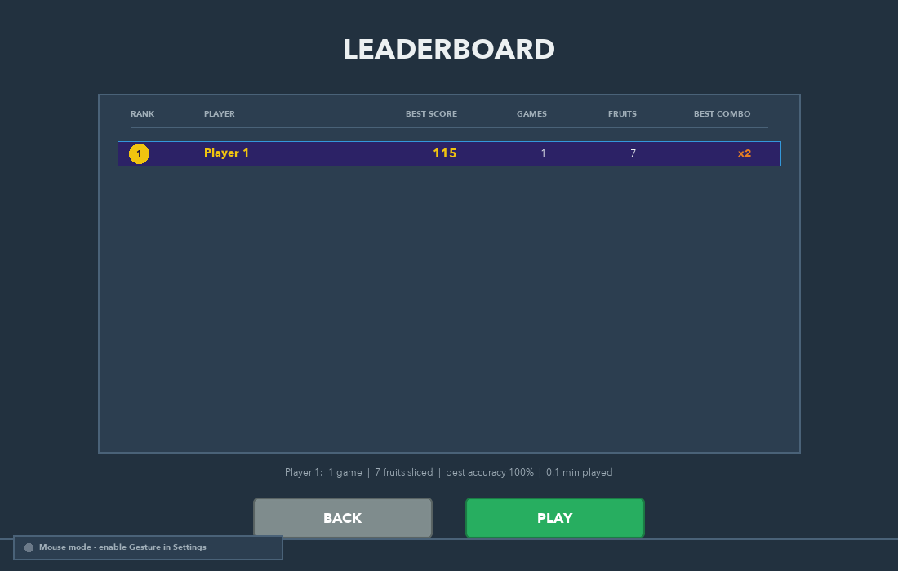
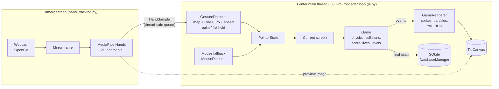

# 🎮 Gaming Arcade — GESTURE SLICE

**A real-time, hand-gesture controlled fruit slicing game for the desktop.**
Your webcam watches your hand, MediaPipe finds your index fingertip, and that
fingertip becomes a glowing blade. Swipe through the fruit, dodge the bombs,
chain combos, and land on the leaderboard. No mouse, keyboard or controller needed.

Built with **Python · Tkinter · OpenCV · MediaPipe · NumPy · Pillow · SQLite**
as an *Advanced Programming Practices (APP)* college project.


| Gameplay | Pause by gesture |
|---|---|
|  |  |
| **Game over** | **Leaderboard** |
|  |  |

---

## Contents

1. [Features](#features)
2. [Quick start](#quick-start)
3. [How to play](#how-to-play)
4. [Project structure](#project-structure)
5. [Architecture](#architecture)
6. [How it works (short version)](#how-it-works-short-version)
7. [Testing](#testing)
8. [Build a double-click desktop app](#build-a-double-click-desktop-app)
9. [Website (Vercel)](#website-vercel)
10. [Troubleshooting](#troubleshooting)
11. [APP concepts demonstrated](#app-concepts-demonstrated)

Detailed documentation lives in [`docs/`](docs/):

| Document | What it explains |
|---|---|
| [ARCHITECTURE.md](docs/ARCHITECTURE.md) | Every module and class, threading model, frame loop |
| [HOW_IT_WORKS.md](docs/HOW_IT_WORKS.md) | Gesture detection, smoothing, collision maths, physics, difficulty, performance |
| [DATABASE.md](docs/DATABASE.md) | SQLite schema, ER diagram, queries |
| [WORKFLOW.md](docs/WORKFLOW.md) | Development stages, runtime workflow, Git + CI workflow |
| [DEMO_GUIDE.md](docs/DEMO_GUIDE.md) | Step-by-step script for the APP project demonstration |

---

## Features

**Hand-gesture control (primary input)**
- Webcam capture with OpenCV on a **background thread**, MediaPipe Hands with all **21 landmarks**
- Index fingertip (landmark 8) is the blade, with a mirrored image so the movement feels natural
- **One Euro filter** smoothing: no jitter when still, no lag on fast swipes
- Velocity-based slicing: only *fast* movements cut, slow ones just aim
- **Open palm held 0.7 s → pause**, **fist held 0.7 s → resume**, with an on-cursor progress ring
- Menus are hands-free too: **hover a fingertip on a button for 1.1 s to press it**
- Live camera preview with the hand skeleton, plus a tracking-status indicator

**Game**
- 7 fruit types (golden star = special, 20 pts), bombs with burning fuses
- Real projectile physics with gravity, spin, and fruit splitting into two halves along your swipe direction
- Juice particles, sparks, juice splats, floating score text, screen shake, red warning flash
- Combos (several fruit in one swipe = bonus), 3 lives, countdown timer, endless levels
- Animated score counter, countdown "3-2-1-SLICE!", level-up banners, procedural sound effects

**App**
- Main menu, How to Play, Leaderboard, Settings, Gameplay, Pause and Game Over screens with fade transitions
- **SQLite**: players, game sessions, high scores, statistics and settings
- Steady **60 FPS** Tkinter rendering (see [performance notes](docs/HOW_IT_WORKS.md#7-performance-how-it-stays-at-60-fps))
- Robust error handling: no webcam, permission denied, camera unplugged, missing packages, database errors.
  The game always falls back to **mouse control**.

---

## Quick start

> **Python 3.9 to 3.12** is required (3.11 recommended). MediaPipe 0.10.14 has no
> wheels for Python 3.13 yet.

### 1. Get the code

```bash
git clone https://github.com/s-shriya2288/APP-project.git
cd APP-project
```

### 2. Create and activate a virtual environment

macOS / Linux:

```bash
python3.11 -m venv .venv
source .venv/bin/activate
```

Windows (PowerShell):

```powershell
py -3.11 -m venv .venv
.venv\Scripts\Activate.ps1
```

You'll see `(.venv)` at the start of the prompt when it's active. Run `deactivate` to leave it.

### 3. Install the dependencies

```bash
pip install -r requirements.txt
```

### 4. Run the game

```bash
python main.py
```

The first time, **macOS asks for camera permission** for your Terminal/IDE.
Click *Allow*. The game keeps retrying for ~30 s, so you don't need to restart.

---

## How to play

| Action | Hand gesture | Mouse / keyboard fallback |
|---|---|---|
| Aim the blade | Point your index finger at the camera | Move the mouse |
| Slice | Swipe your fingertip **fast** through fruit | Move the mouse fast |
| Pause | Hold an **open palm** still for 0.7 s | `Space`, `P`, `Esc` or the II button |
| Resume | Make a **fist** and hold it 0.7 s | `Space` or the Resume button |
| Press a menu button | Hover the fingertip over it for 1.1 s | Click |
| Show FPS counter | – | `F` |

**Scoring:** normal fruit 10 · golden star 20 · combo of *N* fruit in one swipe = +(N − 1) × 15 bonus.
Hitting a bomb costs one of your **3 lives**. The round ends when the timer
(60/90/120 s) reaches zero or you run out of lives.

**Levels:** 1 = slow fruit · 2 = faster fruit · 3 = more bombs · 4+ = faster,
more frequent, bigger waves.

---

## Project structure

```
APP-project/
├── main.py                    # entry point: dependency check, starts the App
├── gesture_slice/             # the game package
│   ├── config.py              # every constant (sizes, colours, timings, rules)
│   ├── ui.py                  # Tkinter App, main loop, widgets, all screens
│   ├── game_engine.py         # Game (rules/logic) + GameRenderer (drawing, HUD)
│   ├── hand_tracking.py       # HandTracker: webcam + MediaPipe on a thread
│   ├── gesture_detection.py   # GestureDetector: smoothing, speed, palm/fist
│   ├── fruit.py               # Fruit, Bomb, FruitHalf + collision maths
│   ├── particle_effects.py    # particles, blade trail, floating text, splats
│   ├── database.py            # DatabaseManager (SQLite)
│   ├── sprites.py             # procedural graphics with Pillow + NumPy
│   ├── sound.py               # procedural sound effects (optional pygame)
│   └── utils.py               # maths / colour helpers
├── tests/                     # 36 unit tests + an automated end-to-end UI run
├── tools/canvas_snapshot.py   # renders the Tk canvas to PNG (screenshots)
├── scripts/                   # build the double-click desktop app
├── docs/                      # documentation + screenshots
├── website/                   # project website deployed on Vercel
├── assets/                    # optional custom fruit images
├── .github/workflows/ci.yml   # GitHub Actions: lint + tests on every push
├── requirements.txt
└── vercel.json
```

---

## Architecture



Full details, class diagram and the per-frame sequence are in
[docs/ARCHITECTURE.md](docs/ARCHITECTURE.md).

---

## How it works (short version)

- **Gesture → blade.** Each camera frame gives landmark 8 (index tip) in 0–1
  coordinates. An inner box of the camera image is stretched over the whole
  game window, smoothed with a One Euro filter, and the movement since the
  previous frame becomes a *cut segment* with a speed in px/s.
- **Slicing = segment vs. circle.** A fruit is a circle. The blade cuts it
  when the shortest distance from the circle centre to the cut segment is ≤
  the radius *and* the segment speed is above the sensitivity threshold.
- **Pause / resume.** Fingers are classified as extended or curled by
  comparing wrist→tip and wrist→middle-joint distances. All four extended =
  open palm, none extended = fist. The pose must be held still for 0.7 s.
- **Smooth at 60 FPS.** The camera never blocks the UI (background thread +
  queue). Images are rendered once at start-up, canvas items are pooled and
  only updated when something changes, and the backdrop is vector-drawn
  because repainting a full-screen photo costs ~30 ms in Tk.

Read [docs/HOW_IT_WORKS.md](docs/HOW_IT_WORKS.md) for the maths and code walk-through.

---

## Testing

```bash
python -m unittest discover -s tests -v     # 36 unit tests (no camera / window needed)
python tests/manual_ui_smoke.py docs/screenshots   # opens the real window, plays itself
```

The smoke test drives every screen, slices fruit with scripted swipes, feeds
fake hand landmarks through the real gesture pipeline (open palm → pause, fist
→ resume), checks that no exception occurs, reports the frame rate and
saves the screenshots used in this README.

GitHub Actions runs lint + unit tests on every push
([`.github/workflows/ci.yml`](.github/workflows/ci.yml)).

---

## Build a double-click desktop app

```bash
pip install -r requirements-dev.txt
./scripts/build_desktop_app.sh        # macOS / Linux  -> dist/GestureSlice(.app)
scripts\build_desktop_app.bat         # Windows        -> dist\GestureSlice\GestureSlice.exe
```

This uses PyInstaller and bundles Python, the libraries and the MediaPipe
hand model into one app you can launch without a terminal (about 30 s to
build, ~260 MB, mostly OpenCV and MediaPipe).

- **macOS:** double-click `dist/GestureSlice.app` (or drag it into *Applications*).
  On first launch macOS asks for camera permission for *Gesture Slice*. Click Allow.
  On a different Mac, the unsigned app must be opened once with
  *right-click → Open* to get past Gatekeeper.
- **Windows:** run `dist\GestureSlice\GestureSlice.exe`.
- The packaged app stores its database in `~/.gesture_slice/`, because the app bundle itself is read-only.
- `dist/` and `build/` are git-ignored, so build the app on the computer that will run it.

---

## Website (Vercel)

Gesture Slice is a **desktop application**. It needs a real window (Tkinter)
and access to your webcam, so it cannot run on a web server. The
[`website/`](website/) folder is the project's **showcase site** (features,
architecture, how to download and run). It's deployed on Vercel:

1. Import this GitHub repository in Vercel (**Add New → Project**).
2. Keep the default settings. `vercel.json` already tells Vercel to serve the
   static `website/` folder (no build step).
3. Click **Deploy**.

---

## Troubleshooting

| Problem | Fix |
|---|---|
| "Camera unavailable" | Close other apps using the camera (Zoom, Teams, browser tabs). On macOS: *System Settings → Privacy & Security → Camera* → enable your Terminal / VS Code / PyCharm, then try again. Try *Settings → Camera 1* if you have several cameras. |
| `No matching distribution found for mediapipe==0.10.14` | Your Python is too new or too old. Use Python 3.9–3.12 (3.11 recommended). |
| Hand not detected | Good lighting, plain background, keep your hand 40–80 cm from the camera, palm facing the camera. |
| Slicing feels hard / too easy | *Settings → Slice sensitivity* (Low / Medium / High). |
| No sound | Install pygame (`pip install pygame`) or check *Settings → Sound effects*. |
| `ModuleNotFoundError: tkinter` (Linux) | `sudo apt install python3-tk` |

---

## APP concepts demonstrated

| Concept | Where |
|---|---|
| Object-oriented design (classes, inheritance, encapsulation) | `GameObject → Fruit / Bomb / FruitHalf`, `Screen → MainMenuScreen …`, `HandTracker`, `GestureDetector`, `DatabaseManager`, `Particle` |
| Multithreading + thread-safe communication | `HandTracker` thread → `queue.Queue` → main thread; `threading.Lock` for the preview |
| Event-driven GUI programming | Tkinter bindings (`<Motion>`, `<Button-1>`, `<Key>`), `root.after` game loop |
| Computer vision | OpenCV capture, MediaPipe hand landmarks, gesture classification |
| Numerical computing | NumPy distance maths, procedural images and sound synthesis |
| Database integration | SQLite schema with foreign keys, UPSERT, transactions, indices |
| Algorithms | Segment–circle intersection, One Euro filter, projectile physics, object pooling |
| Error handling | Camera/permission/disconnect recovery, missing packages, DB fallback to memory |
| Testing | `unittest` suite + automated end-to-end UI test + GitHub Actions CI |

---

## License

[MIT](LICENSE)
