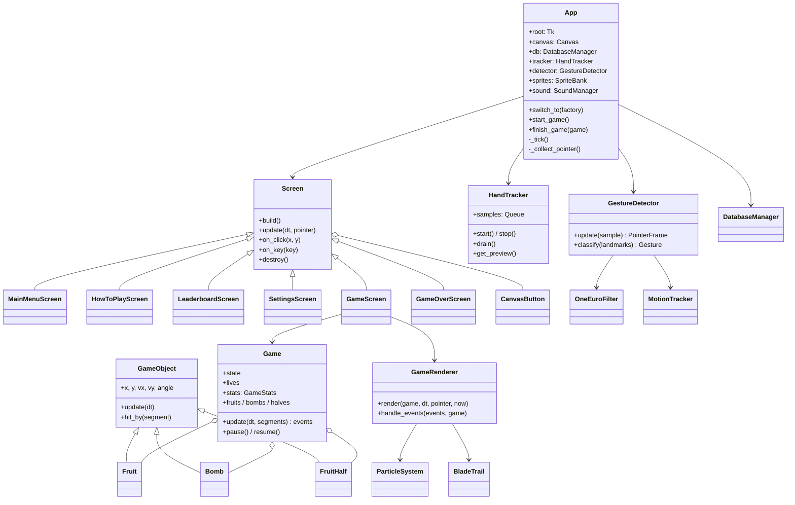
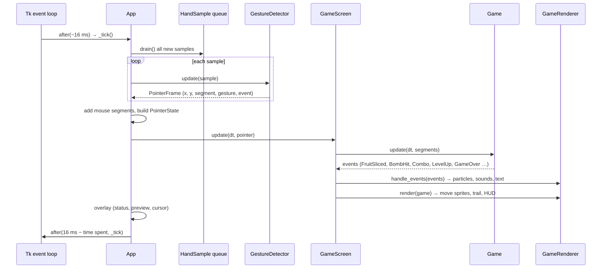
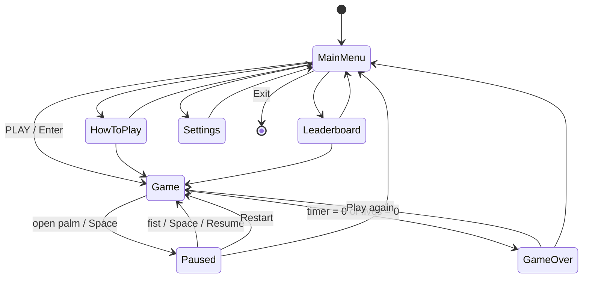

# Architecture

Gesture Slice is split into small modules, each with one job. Data flows
in one direction: **camera → gestures → game rules → drawing → database**.

## 1. Module overview

| Module | Main classes / functions | Responsibility |
|---|---|---|
| `main.py` | `main()`, `check_dependencies()` | Entry point. Checks the Python version and the required packages, then starts `App`. |
| `config.py` | constants | Every tunable number: window size, FPS, colours, gravity, scoring, gesture timings, camera settings, default settings. |
| `ui.py` | `App`, `Screen`, `MainMenuScreen`, `HowToPlayScreen`, `LeaderboardScreen`, `SettingsScreen`, `GameScreen`, `GameOverScreen`, `CanvasButton`, `FontBook`, `PointerState` | The Tkinter application: window, the 60 FPS `root.after` loop, input merging (hand + mouse), screen switching, the status/preview overlay. |
| `game_engine.py` | `Game`, `GameRenderer`, `GameStats`, `LevelSettings`, event classes | `Game` = pure rules (spawning, physics update, collisions, score, combos, lives, timer, levels). `GameRenderer` = draws a `Game` on the canvas and turns its events into effects and sounds. |
| `hand_tracking.py` | `HandTracker`, `HandSample`, `TrackerStatus` | Opens the webcam, runs MediaPipe Hands on a background thread, publishes `HandSample`s through a `queue.Queue`, keeps a small preview image, recovers from disconnections. |
| `gesture_detection.py` | `GestureDetector`, `MouseDetector`, `OneEuroFilter`, `MotionTracker`, `Gesture`, `PointerFrame` | Turns landmarks into a smoothed blade position, cut segments with speed, and pause/resume commands (pose classification + hold-to-confirm). |
| `fruit.py` | `FruitType`, `GameObject`, `Fruit`, `FruitHalf`, `Bomb`, `segment_intersects_circle()` | The flying objects (state + physics only, no Tk) and the collision maths. |
| `particle_effects.py` | `ParticleSystem`, `Particle`, `BladeTrail`, `FloatingText`, `Splat`, `CanvasState` | Visual effects with pooled canvas items, plus `CanvasState`, which skips redundant Tk calls. |
| `sprites.py` | `SpriteBank`, `render_*()`, `draw_background()`, `draw_panel()` | All graphics, generated with Pillow/NumPy: shaded fruit, halves, bombs, splats, buttons, hearts, hand icons, titles. Rotation frames are pre-computed once. |
| `database.py` | `DatabaseManager` | SQLite schema creation, saving sessions, high scores, statistics, leaderboard and settings. |
| `sound.py` | `SoundManager` | Optional sound effects synthesised with NumPy and played through pygame's mixer. Silent when pygame is missing. |
| `utils.py` | `clamp`, `lerp`, `lerp_color`, easing functions | Small shared helpers. |

## 2. Class diagram

## 3. Threading model

There are exactly **two threads**:

| Thread | Runs | Never does |
|---|---|---|
| **Main (Tk)** | Tkinter event loop, the 60 FPS game loop, gesture detection, game rules, drawing, database, sound triggers | Never waits for the camera |
| **HandTracker** (daemon) | `cap.read()`, mirror, `cv2.cvtColor`, `hands.process()`, building the preview image | Never touches Tkinter |

They talk through:

- `queue.Queue(maxsize=32)` of immutable `HandSample` objects (camera → game).
  `put_nowait` drops the oldest sample if the game ever falls behind, so the
  camera thread never blocks.
- a `threading.Lock` protecting the latest preview image, FPS and status text.
- a `threading.Event` to ask the worker to stop. `stop()` joins the thread
  and releases the camera.

The camera is **opened on the main thread**, because macOS only shows the
camera-permission prompt there. Reading and processing happen on the worker.

## 4. One frame of the game loop

The delay of the next `after()` call is `16 ms − time already spent`, so the
loop holds a steady 60 FPS. `dt` (time since the last frame, capped at 50 ms)
drives all physics, so the game runs at the same speed even if a frame is late.

## 5. Screens and navigation

Every screen is a `Screen` subclass. `App.switch_to()` remembers the next screen; at the
start of the next frame it calls `destroy()` on the old screen (deleting all its
canvas items by tag) and `build()`s the new one.

## 6. Design decisions

- **Logic separated from drawing.** `Game`, `Fruit`, `GestureDetector` and
  `DatabaseManager` never import Tkinter, so they are unit-tested without a
  window or a camera.
- **Events instead of callbacks.** `Game.update()` returns a list of event
  objects. The renderer decides how each event looks and sounds, so the
  rules stay free of presentation code.
- **One canvas, tagged items.** All screens draw on one `Canvas`, and each
  item carries its screen's tag, so cleaning up a screen is one
  `canvas.delete(tag)`.
- **Graceful degradation.** No camera, no MediaPipe, no pygame or an
  unwritable database never stop the game. Each one switches to a fallback
  and shows a short notice.
