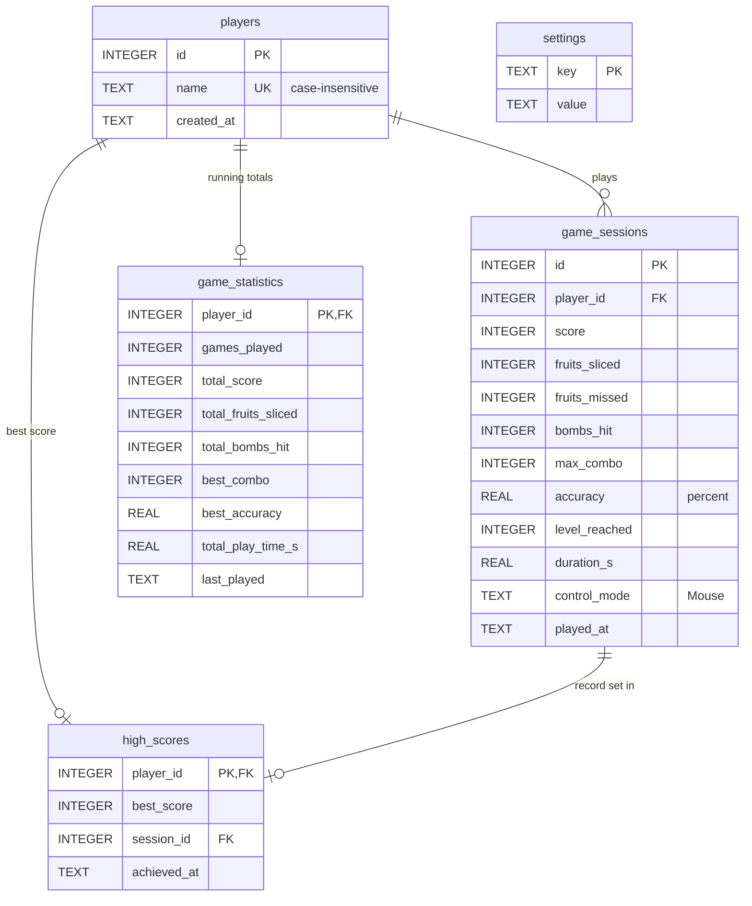

# Database

Gesture Slice stores everything in one SQLite file, `data/gesture_slice.db`,
created automatically on the first run (the `data/` folder is git-ignored).
All SQL lives in `gesture_slice/database.py` → `DatabaseManager`.

## Entity–relationship diagram



## Tables

| Table | One row per | Written when |
|---|---|---|
| `players` | player name | first game with that name |
| `game_sessions` | finished game | every game over |
| `high_scores` | player | a game beats the player's best |
| `game_statistics` | player | every game over (totals accumulate) |
| `settings` | setting (`player_name`, `sound`, `round_seconds`, `sensitivity`) | a value changes on the Settings screen |

Foreign keys are enforced (`PRAGMA foreign_keys = ON`), and indices exist on
`game_sessions(player_id)` and `high_scores(best_score DESC)`.

## Saving a game: one transaction

`DatabaseManager.record_session()` runs inside `with self.conn:`. Either
all three tables are updated, or, if anything fails, none are:

```sql
-- 1. the session itself
INSERT INTO game_sessions (player_id, score, ...) VALUES (?, ?, ...);

-- 2. high score: insert, or raise only if the new score is better (UPSERT)
INSERT INTO high_scores (player_id, best_score, session_id, achieved_at)
VALUES (?, ?, ?, ?)
ON CONFLICT(player_id) DO UPDATE SET
    best_score = excluded.best_score, session_id = excluded.session_id,
    achieved_at = excluded.achieved_at
WHERE excluded.best_score > high_scores.best_score;

-- 3. statistics: add to the running totals
INSERT INTO game_statistics (...) VALUES (...)
ON CONFLICT(player_id) DO UPDATE SET
    games_played = games_played + 1,
    total_score  = total_score + excluded.total_score,
    best_combo   = MAX(best_combo, excluded.best_combo), ...;
```

## Leaderboard query

```sql
SELECT p.name, h.best_score, s.games_played, s.total_fruits_sliced, s.best_combo
FROM high_scores h
JOIN players p         ON p.id = h.player_id
JOIN game_statistics s ON s.player_id = h.player_id
ORDER BY h.best_score DESC, h.achieved_at ASC   -- ties: whoever got there first
LIMIT 10;
```

## Error handling

- If the database file can't be created or opened (read-only folder,
  corrupt file), `DatabaseManager` switches to an **in-memory database**, so
  the game still works. A notice says scores won't be kept.
- If saving a game fails, the transaction is rolled back, the Game Over
  screen shows the reason, and the game continues.

## Inspecting the data

```bash
sqlite3 data/gesture_slice.db
sqlite> .tables
sqlite> SELECT * FROM game_sessions ORDER BY id DESC LIMIT 5;
```
