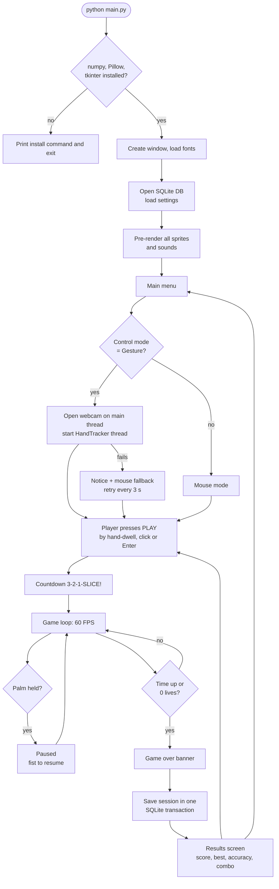

# Workflow

This document covers three workflows: how the project was **built** (stages),
how the program **runs** (runtime workflow), and how the code is **managed**
(Git + continuous integration).

---

## 1. Development workflow: 9 stages

Each stage was finished and tested before the next one started.

| Stage | Goal | What was built | How it was tested |
|---|---|---|---|
| 0. Environment | Find a working Python + MediaPipe combination | Python 3.11 virtual env; `mediapipe==0.10.14` (still ships `mp.solutions.hands`); `opencv-contrib-python==4.10.0.84` (newer 5.x bundles SDL2, which clashes with pygame on macOS) | `python -c "import cv2, mediapipe"`, model loads |
| 1. Window + menu | Tkinter app skeleton | `App`, `Screen`, `MainMenuScreen`, `CanvasButton`, fade transitions, `config.py` | Window opens, buttons react to mouse |
| 2. Webcam | Camera without freezing the UI | `HandTracker` thread, `queue.Queue`, preview image, status messages, permission/disconnect handling | Fake camera test: frames flow, disconnect → auto-reconnect, `stop()` releases the camera |
| 3. Hand tracking | 21 landmarks | MediaPipe Hands on the worker thread, mirrored frames, skeleton overlay in the preview | Model loads and processes frames at camera rate |
| 4. Blade + trail | Fingertip becomes a blade | `GestureDetector` (mapping, One Euro filter, speed, segments), `BladeTrail`, hand cursor, dwell-click | Unit tests: mapping clamps, jitter reduced, swipe speed, hand-lost reset |
| 5. Fruit + physics + collisions | The core game | `Fruit`, `FruitHalf`, launch maths, segment–circle collision, slicing into halves | Unit tests: collision edge cases, every throw peaks on screen and falls back down |
| 6. Bombs, scoring, lives, levels | Full rules | `Bomb`, `Game` state machine, combos, timer, `level_for_score`, `settings_for_level` | Unit tests: points, specials, combos, 3 bombs end the game, timer, pause freezes the game, 2-minute random fuzz game |
| 7. Animations + sound | Polish | Procedural sprites (Pillow/NumPy), particles, splats, floating text, shake, warning flash, synthesized sounds | Visual check through screenshots |
| 8. SQLite | Persistence | `DatabaseManager`, five tables, UPSERT transaction, leaderboard, settings | Unit tests on a temporary database, including the fallback when the file can't be written |
| 9. Testing + fixing + docs | Ship it | End-to-end UI test, performance work (30 → 60 FPS), docs, CI, website | `tests/manual_ui_smoke.py`: all screens, scripted play, palm→pause, fist→resume, 0 errors, ~60 FPS |

### Bugs found and fixed in stage 9

| Symptom | Cause | Fix |
|---|---|---|
| Gameplay only ~30 FPS, menu ~20 FPS | Tk repaints the bounding box of all changes, and a full-window photo background takes ~30 ms to repaint on macOS | Background and panels drawn with vector shapes; title image cropped; decorative menu fruit kept away from big images |
| Idle frames still slow | Unchanged values re-sent to Tk every frame (each call repaints) | `CanvasState` only sends values that changed |
| Warning "Class SDL… implemented in both" | OpenCV 5 and pygame each ship SDL2 | Pinned `opencv-contrib-python==4.10.0.84` |
| First launch on macOS: camera fails | Permission dialog is still open on the first attempt | App retries every 3 s (up to 10×) while in gesture mode |
| Fingertip "teleport" sliced everything | Hand left and came back elsewhere → huge segment | Motion state reset when the hand is lost; samples > 0.25 s apart never form a cut |
| Pause triggered while slicing with an open hand | Pose alone was enough | Pose must be held 0.7 s **and** the hand must be nearly still |
| Hand cursor hidden under the pause panel | Drawing order | Cursor raised above overlays |

---

## 2. Runtime workflow: what happens when you play



---

## 3. Code management workflow (Git + CI)

```
main  ←  feature branches  ←  commits
          │
          └─ every push / pull request → GitHub Actions (ci.yml)
                 1. set up Python 3.11 on Ubuntu
                 2. pip install numpy Pillow pyflakes
                 3. pyflakes gesture_slice main.py tests tools   (lint)
                 4. python -m unittest discover -s tests          (36 tests)
```

- The unit tests never need a camera or a window, because logic is
  separated from Tkinter. That's why they can run in CI.
- The end-to-end test (`tests/manual_ui_smoke.py`) needs a display, so it
  runs locally before a release and also regenerates `docs/screenshots/`.

### Suggested team workflow

1. `git checkout -b feature/<name>`
2. Make the change and run `python -m unittest discover -s tests`
3. Commit with a clear message, then push
4. Open a pull request, wait for the green CI check, merge into `main`
5. Vercel redeploys the project website automatically on every push to `main`
