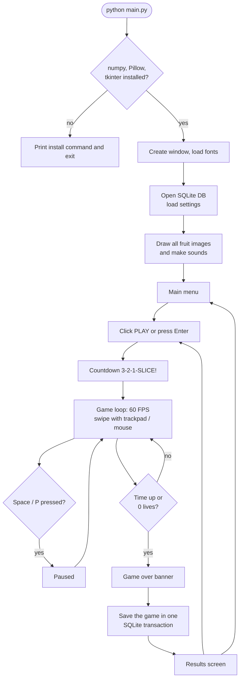

# Workflow

This file explains how we **built** the project (stages), how the program
**runs**, and how the code is **managed** with Git and GitHub Actions.

---

## 1. How we built it (stages)

We finished and tested each stage before starting the next one.

| Stage | Goal | What we built | How we tested it |
|---|---|---|---|
| 1. Window + menu | Tkinter app skeleton | `App`, `Screen`, `MainMenuScreen`, `CanvasButton`, `config.py` | Window opens, buttons react to the mouse |
| 2. Blade + trail | Pointer becomes a knife | `MouseDetector` / `MotionTracker` (segments + speed), `BladeTrail` | Unit tests: segment speed, long pause breaks the line |
| 3. Fruit + physics + collisions | The main game | `Fruit`, `FruitHalf`, throwing maths, segment–circle collision, cutting into halves | Unit tests: collision edge cases, every throw goes up and comes back down |
| 4. Bombs, score, lives, levels | Full rules | `Bomb`, `Game` state machine, combos, timer, `level_for_score`, `settings_for_level` | Unit tests: points, combos, 3 bombs end the game, timer, pause |
| 5. Effects + sound | Make it fun | Fruit images drawn with Pillow, juice particles, splats, floating text, sounds | Checked with screenshots |
| 6. SQLite | Save scores | `DatabaseManager`, tables, leaderboard, settings | Unit tests on a temporary database |
| 7. Testing + docs | Finish | End-to-end UI test, speed fixes (30 → 60 FPS), docs, CI | `tests/manual_ui_smoke.py`: every screen, scripted play, pause/resume, 0 errors |

### Bugs we found and fixed

| Problem | Cause | Fix |
|---|---|---|
| Game ran at only ~30 FPS | Tk repaints the whole changed area, and a full-window background image is slow to repaint | Background and panels drawn with plain shapes |
| Still slow when nothing changed | The same values were sent to Tk every frame | `CanvasState` only sends values that changed |
| A quick jump of the pointer cut everything in between | Two points far apart in time made one huge segment | Points more than 0.25 s apart never make a cut |
| Pointer hidden under the pause panel | Drawing order | Cursor raised above overlays |

---

## 2. What happens when you play



---

## 3. Git + GitHub Actions

```
main  ←  feature branches  ←  commits
          │
          └─ every push / pull request → GitHub Actions (ci.yml)
                 1. set up Python 3.10 / 3.11 / 3.12 on Ubuntu
                 2. pip install numpy Pillow pyflakes
                 3. pyflakes main.py gesture_slice tests tools   (lint)
                 4. python -m unittest discover -s tests          (unit tests)
```

- The unit tests don't need a window because the game logic is separate
  from Tkinter, so they can run on GitHub's servers.
- The end-to-end test (`tests/manual_ui_smoke.py`) opens the real window, so
  we run it on our laptop. It also makes the screenshots in `docs/screenshots/`.

### Team workflow

1. `git checkout -b feature/<name>`
2. Make the change and run `python -m unittest discover -s tests`
3. Commit with a clear message, then push
4. Open a pull request, wait for the green check, merge into `main`
